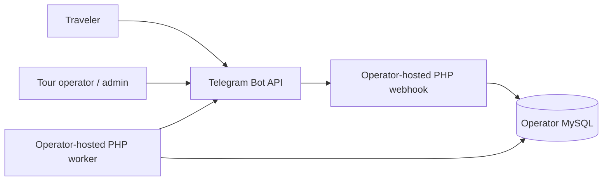
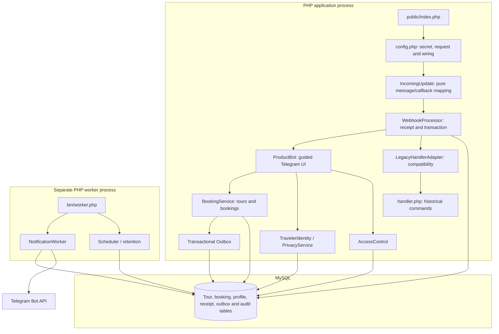

# Architecture and database contracts

`public/index.php` → authenticated/private-update validation in `config.php` →
`WebhookProcessor` → `ProductBot` → domain services → MySQL + outbox.
`bin/worker.php` separately schedules reminders/retention and dispatches the outbox.
The established handler remains available for legacy commands through
`LegacyHandlerAdapter`. The adapter is the sole production include site for
`src/handler.php`; it scopes the legacy variables and message strings to a
single call while preserving the enclosing `WebhookProcessor` transaction.
`tests/workflow_test.php` exercises that exact production boundary against
disposable MySQL/MariaDB databases. The adapter does **not** claim to make
the old handler pure or remove its legacy helper functions and global database
context. Any subsequent refactor must first preserve these integration cases.

### Architecture decision: contain legacy code before migrating it

Keep the existing modular monolith. Use a narrow adapter around the
side-effecting include instead of rewriting membership/announcement commands
in one step. The preferred direction for new work is
Telegram presentation → application services → transactional persistence/outbox.
New booking logic belongs in services, not in the compatibility handler.
This isolates the old execution contract for incremental removal without
changing booking, payment or notification rules.

| Component | Responsibility |
|---|---|
| Database | UTC connections, prepared queries, transaction boundaries and bounded deadlock retry |
| BookingService | Tour validation, price snapshots, capacity, authorization, state transitions, history and payment review |
| BookingReportService | Role-checked booking summary and allowlisted, formula-neutralized CSV; Telegram UI retains delivery and audit ordering |
| ProductBot | Guided Persian Telegram UI; callback actions are grouped by profile, traveler, tour admin, and booking admin with explicit default denial; forms are grouped by purpose |
| BotSessionStore | Persistent per-user forms, 30-minute expiration, required-state verification, clearing |
| AccessControl | Owner configuration, DB roles, least-privilege checks, audit events |
| Outbox / NotificationWorker | Idempotent enqueue, durable dispatch state, retries/leases and delivery permissions |
| NotificationAdminService | Authorized notification status/read model and batched broadcast enqueue; ProductBot only renders the Telegram UI |
| PaymentAdapter / PaymentService | Verified events, unique order/transaction identity, amount/freshness checks |
| PrivacyService / Scheduler | Explicit erasure, inactive-profile retention, reminders and unpaid hold expiration |

## Testable ingress normalization

`config.php` authenticates the HTTP request and rejects unsupported updates
before opening the database connection. `IncomingUpdate::context()` maps the
already-supported private message or callback into the previous lexical
request fields **without I/O**. It rejects invalid updates if called on its
own. Sensitive administrator callbacks remain checked and denied in the HTTP
bootstrap before dispatch; this mapping does not authorize requests.

`tests/incoming_update_test.php` covers message, callback, own-contact shape,
legacy false/null defaults and unsupported update rejection without MySQL.
The end-to-end HTTP, legacy compatibility, and MySQL/MariaDB tests remain the
authoritative regression gates for the whole pipeline.

## Runtime view (self-hosted reference deployment)

These diagrams describe the source an **operator** may install. The repository
does not host a running bot, database, or webhook.

### C4-style system context



### Containers and key components



### Reservation and notification sequence

```mermaid
sequenceDiagram
    participant T as Telegram update
    participant H as HTTP/bootstrap
    participant P as WebhookProcessor
    participant B as BookingService
    participant DB as MySQL
    participant W as NotificationWorker
    participant API as Telegram Bot API

    T->>H: POST with webhook secret
    H->>H: Validate private update and map context
    H->>P: Dispatch update
    P->>DB: BEGIN / receipt uniqueness
    P->>B: Reserve seats
    B->>DB: Lock user and tour; check capacity
    B->>DB: Store booking, history, outbox event
    P->>DB: COMMIT
    P-->>T: HTTP acknowledgement
    W->>DB: Claim queued outbox event
    W->>API: Send notification
    W->>DB: Mark sent or schedule retry
```

The sequence is simplified: a duplicate update can short-circuit on its stored
receipt, and `Database::atomic` retries eligible deadlocks. No Telegram API call
occurs inside the booking transaction. Notifications are **at least once**;
an acknowledgement crash can produce a duplicate external message.

## Architectural decision records

- [ADR 0001 — Keep a modular monolith](adr/0001-modular-monolith.md)
- [ADR 0002 — Transactional outbox](adr/0002-transactional-outbox.md)
- [ADR 0003 — Contain the legacy handler](adr/0003-legacy-handler-compatibility.md)
- [ADR 0004 — Separate encrypted traveler identity](adr/0004-encrypted-traveler-identity.md)

## Additive migration lineage

001 retains old Data/Topics and copies `topic<id>` statuses into TopicMemberships.
002 adds product tables and does not invent dates, prices, tours or bookings from
memberships. Migration 003 adds encrypted traveler identity columns in a separate table, without copying plaintext legacy identifiers. An operator can associate a new tour with an existing category.
Both migrations serialize their own runs and retain version markers. DDL is
additive/resumable and is not claimed to roll back atomically in MySQL.

| Table | Purpose / constraints |
|---|---|
| Data | Existing profile ID/name; nullable legacy PII fields remain for compatibility |
| TravelerIdentity | Encrypted Telegram-shared phone and checksum-validated national code; cascade deletion with account |
| Topics / TopicMemberships | Existing category hierarchy / unique legacy membership |
| Tours | Category FK (restrict deletion), UTC dates, integer IRR price, capacity, publication, version |
| Bookings | Unique user/tour and request key, quantity, price snapshot, status/version; account FK becomes null on deletion |
| BookingParticipants | One ordinal per seat; no unnecessary identity fields required |
| BookingStatusHistory | Append-only transitions with actor, optional reason, UTC time |
| Payments | One payment/order per booking; unique random order and hashed provider/manual transaction reference |
| AdminRoles / AuditLog | Permission assignment and sensitive-operation metadata, without raw profile/payment payloads |
| NotificationOutbox | Hashed event key, JSON payload, pending/processing/sent/failed, attempts, available/locked/sent timestamps |
| UpdateReceipts | Globally unique Telegram update ID; committed with effects and responses |
| BotSessions / RateLimits | Per-user persistent forms with expiration / bounded per-minute ingress |

## Capacity and state machine

Reservations lock the user and then the tour. Every capacity-changing operation
locks that tour before reading/modifying its bookings. Capacity reads use locking
current reads, including when an outer transaction has already established a
repeatable-read snapshot. This avoids stale SUM queries and overbooking.
Unique keys independently prevent repeated bookings and duplicate event enqueue.
Deadlock/lock-timeout retries rerun the entire owning transaction up to five times;
no Telegram network request occurs in that transaction.

Pending, confirmed and completed quantities count toward occupied seats. Completed
rows preserve historical capacity; no new booking is accepted after tour start.
Rejected/cancelled rows free capacity. One booking per account/tour is retained;
there is no self-service rebooking after a terminal state. Capacity cannot be
reduced below occupied seats. Price edits do not alter existing payment amounts.

Allowed transitions: pending → confirmed/rejected/cancelled;
confirmed → cancelled/completed. Travelers may cancel only their own reservation
before start; reviewers may approve/reject, and completion requires the tour to
have ended. A positive-price booking cannot be confirmed until payment is paid.
Repeated transitions to the current state do not create history/notifications.

## Queue and external boundaries

A domain change and its outbox events commit together; HTTP replays are receipted.
The worker holds a database advisory lock to serialize dispatch, recovers processing
leases after five minutes, uses per-chat/global throttling and honors retry_after.
Permanent errors become failed, retryable transport/429/5xx failures use bounded
exponential backoff and at most eight attempts. A retry is auditable. Export
permission is rechecked at delivery, and obsolete/cancelled reminders are skipped.
No raw Telegram error bodies, token URLs or personal data are written to logs.
Large UTF-8 messages are split into bounded Unicode chunks.

The provider/DB acknowledgement gap permits duplicates after a crash: delivery is
at least once, not exactly once. Queue keys prevent duplicate logical events, not
an external API accepting the same HTTP request twice.

Only the local HMAC sandbox adapter is shipped. It cannot move money. A real
adapter must perform authoritative server verification and use a merchant account;
refunds require an additional reviewed policy/integration. These are external gates.

Account erasure blocks active bookings, removes old PII/participants/sessions,
anonymizes booking ownership/history and purges queued personal profile messages.
Amounts, counts and hashed transaction uniqueness remain without account linkage.
Existing Telegram messages and offline backups need the operator's own retention
and access policy. See SECURITY.md.

Automatic profile retention is opt-in by default. Explicit erasure keeps only the
minimal ingress counter for at most one day so deletion cannot reset abuse limits.
Receipt replay protection lasts 30 days; terminal queue payloads last seven days.

Booking-specific traveler/manager messages are queued with subject ownership and
permission metadata. Staff replies are authorized against the staff sender, not
the traveler recipient, and are audited. Account erasure purges queued personal
correspondence by subject. This enables manual payment coordination inside the bot
without disclosing traveler Telegram IDs or collecting banking/card data.

## Architecture fitness check

`tests/architecture_test.php` scans the **actual production PHP tree** with the
PHP tokenizer. It fails if fewer than 15 files are scanned or if the legacy
handler is included from anywhere other than `LegacyHandlerAdapter`. It runs
on PHP 8.0–8.4 in CI and via `composer test:unit`. This narrow regression
guard is intentionally not described as full layering/static-analysis coverage;
additional rules should follow only when real layer boundaries exist.
