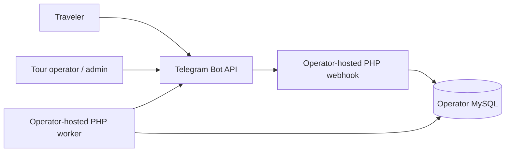
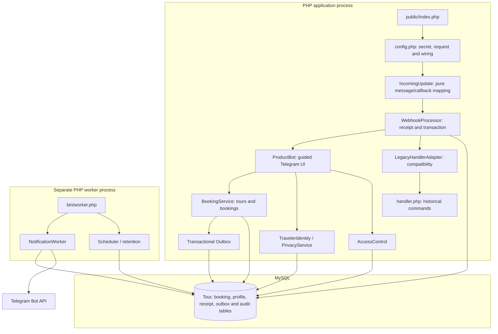
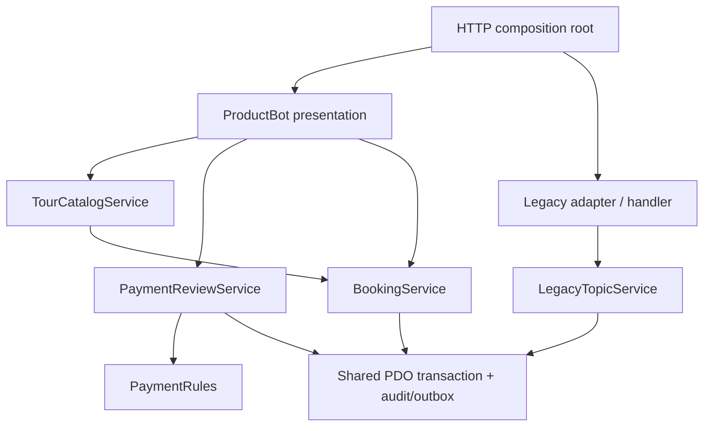

# Architecture and database contracts

`public/index.php` → authenticated/private-update validation in `config.php` →
`WebhookProcessor` → `ProductBot` → domain services → MySQL + outbox.
`bin/worker.php` separately schedules reminders/retention and dispatches the outbox.
The established handler remains available for legacy commands through
`LegacyHandlerAdapter`. The adapter is the sole production include site for
`src/handler.php`; it scopes the legacy variables and message strings to a
single call while preserving the enclosing `WebhookProcessor` transaction.
`tests/workflow_test.php` exercises that exact production boundary against
disposable MySQL/MariaDB databases. The adapter does **not** claim to make
the old handler pure or remove its legacy helper functions and global response helpers. Persistence now lives in explicit legacy services. Any subsequent refactor must first preserve these integration cases.

### Architecture decision: contain legacy code before migrating it

Keep the existing modular monolith. Use a narrow adapter around the
side-effecting include instead of rewriting membership/announcement commands
in one step. The preferred direction for new work is
Telegram presentation → application services → transactional persistence/outbox.
New booking logic belongs in services, not in the compatibility handler.
This isolates the old execution contract for incremental removal without
changing booking, payment or notification rules.

| Component | Responsibility |
|---|---|
| Database | UTC connections, prepared queries, transaction boundaries and bounded deadlock retry |
| BookingService | Tour validation, price snapshots, capacity, authorization, state transitions and history; compatibility delegation for manual payment review |
| TourCatalogService | Authorized tour list/search, categories and visibility/capacity read model; no Telegram or session dependency |
| PaymentReviewService / PaymentRules | Manual review authorization, reference validation, tour→booking→payment lock order, audit and notification; pure reference format rule |
| BookingReportService | Role-checked booking summary and allowlisted, formula-neutralized CSV; Telegram UI retains delivery and audit ordering |
| LegacyTopicService | Configured-owner category creation/caption forms, explicit PDO/catalogue dependencies; no Telegram helpers or globals |
| ProductBot | Guided Persian Telegram UI; callback actions are grouped by profile, traveler, tour admin, and booking admin with explicit default denial; forms are grouped by purpose |
| BotSessionStore | Persistent per-user forms, 30-minute expiration, required-state verification, clearing |
| AccessControl | Owner configuration, DB roles, least-privilege checks, audit events |
| Outbox / NotificationWorker | Idempotent enqueue, durable dispatch state, retries/leases and delivery permissions |
| NotificationAdminService | Authorized notification status/read model and batched broadcast enqueue; ProductBot only renders the Telegram UI |
| PaymentAdapter / PaymentService | Verified events, unique order/transaction identity, amount/freshness checks |
| PrivacyService / Scheduler | Explicit erasure, inactive-profile retention, reminders and unpaid hold expiration |

## Testable ingress normalization

`config.php` authenticates the HTTP request and rejects unsupported updates
before opening the database connection. `IncomingUpdate::context()` maps the
already-supported private message or callback into the previous lexical
request fields **without I/O**. It rejects invalid updates if called on its
own. Sensitive administrator callbacks remain checked and denied in the HTTP
bootstrap before dispatch; this mapping does not authorize requests.

`tests/incoming_update_test.php` covers message, callback, own-contact shape,
legacy false/null defaults and unsupported update rejection without MySQL.
The end-to-end HTTP, legacy compatibility, and MySQL/MariaDB tests remain the
authoritative regression gates for the whole pipeline.

## Runtime view (self-hosted reference deployment)

These diagrams describe the source an **operator** may install. The repository
does not host a running bot, database, or webhook.

### C4-style system context



### Containers and key components



### Reservation and notification sequence

```mermaid
sequenceDiagram
    participant T as Telegram update
    participant H as HTTP/bootstrap
    participant P as WebhookProcessor
    participant B as BookingService
    participant DB as MySQL
    participant W as NotificationWorker
    participant API as Telegram Bot API

    T->>H: POST with webhook secret
    H->>H: Validate private update and map context
    H->>P: Dispatch update
    P->>DB: BEGIN / receipt uniqueness
    P->>B: Reserve seats
    B->>DB: Lock user and tour; check capacity
    B->>DB: Store booking, history, outbox event
    P->>DB: COMMIT
    P-->>T: HTTP acknowledgement
    W->>DB: Claim queued outbox event
    W->>API: Send notification
    W->>DB: Mark sent or schedule retry
```

The sequence is simplified: a duplicate update can short-circuit on its stored
receipt, and `Database::atomic` retries eligible deadlocks. No Telegram API call
occurs inside the booking transaction. Notifications are **at least once**;
an acknowledgement crash can produce a duplicate external message.

## Architectural decision records

- [ADR 0001 — Keep a modular monolith](adr/0001-modular-monolith.md)
- [ADR 0002 — Transactional outbox](adr/0002-transactional-outbox.md)
- [ADR 0003 — Contain the legacy handler](adr/0003-legacy-handler-compatibility.md)
- [ADR 0004 — Separate encrypted traveler identity](adr/0004-encrypted-traveler-identity.md)

## Additive migration lineage

001 retains old Data/Topics and copies `topic<id>` statuses into TopicMemberships.
002 adds product tables and does not invent dates, prices, tours or bookings from
memberships. Migration 003 adds encrypted traveler identity columns in a separate table, without copying plaintext legacy identifiers. An operator can associate a new tour with an existing category.
Both migrations serialize their own runs and retain version markers. DDL is
additive/resumable and is not claimed to roll back atomically in MySQL.

| Table | Purpose / constraints |
|---|---|
| Data | Existing profile ID/name; nullable legacy PII fields remain for compatibility |
| TravelerIdentity | Encrypted Telegram-shared phone and checksum-validated national code; cascade deletion with account |
| Topics / TopicMemberships | Existing category hierarchy / unique legacy membership |
| Tours | Category FK (restrict deletion), UTC dates, integer IRR price, capacity, publication, version |
| Bookings | Unique user/tour and request key, quantity, price snapshot, status/version; account FK becomes null on deletion |
| BookingParticipants | One ordinal per seat; no unnecessary identity fields required |
| BookingStatusHistory | Append-only transitions with actor, optional reason, UTC time |
| Payments | One payment/order per booking; unique random order and hashed provider/manual transaction reference |
| AdminRoles / AuditLog | Permission assignment and sensitive-operation metadata, without raw profile/payment payloads |
| NotificationOutbox | Hashed event key, JSON payload, pending/processing/sent/failed, attempts, available/locked/sent timestamps |
| UpdateReceipts | Globally unique Telegram update ID; committed with effects and responses |
| BotSessions / RateLimits | Per-user persistent forms with expiration / bounded per-minute ingress |

## Capacity and state machine

Reservations lock the user and then the tour. Every capacity-changing operation
locks that tour before reading/modifying its bookings. Capacity reads use locking
current reads, including when an outer transaction has already established a
repeatable-read snapshot. This avoids stale SUM queries and overbooking.
Unique keys independently prevent repeated bookings and duplicate event enqueue.
Deadlock/lock-timeout retries rerun the entire owning transaction up to five times;
no Telegram network request occurs in that transaction.

Pending, confirmed and completed quantities count toward occupied seats. Completed
rows preserve historical capacity; no new booking is accepted after tour start.
Rejected/cancelled rows free capacity. One booking per account/tour is retained;
there is no self-service rebooking after a terminal state. Capacity cannot be
reduced below occupied seats. Price edits do not alter existing payment amounts.

Allowed transitions: pending → confirmed/rejected/cancelled;
confirmed → cancelled/completed. Travelers may cancel only their own reservation
before start; reviewers may approve/reject, and completion requires the tour to
have ended. A positive-price booking cannot be confirmed until payment is paid.
Repeated transitions to the current state do not create history/notifications.

## Queue and external boundaries

A domain change and its outbox events commit together; HTTP replays are receipted.
The worker holds a database advisory lock to serialize dispatch, recovers processing
leases after five minutes, uses per-chat/global throttling and honors retry_after.
Permanent errors become failed, retryable transport/429/5xx failures use bounded
exponential backoff and at most eight attempts. A retry is auditable. Export
permission is rechecked at delivery, and obsolete/cancelled reminders are skipped.
No raw Telegram error bodies, token URLs or personal data are written to logs.
Large UTF-8 messages are split into bounded Unicode chunks.

The provider/DB acknowledgement gap permits duplicates after a crash: delivery is
at least once, not exactly once. Queue keys prevent duplicate logical events, not
an external API accepting the same HTTP request twice.

Only the local HMAC sandbox adapter is shipped. It cannot move money. A real
adapter must perform authoritative server verification and use a merchant account;
refunds require an additional reviewed policy/integration. These are external gates.

Account erasure blocks active bookings, removes old PII/participants/sessions,
anonymizes booking ownership/history and purges queued personal profile messages.
Amounts, counts and hashed transaction uniqueness remain without account linkage.
Existing Telegram messages and offline backups need the operator's own retention
and access policy. See SECURITY.md.

Automatic profile retention is opt-in by default. Explicit erasure keeps only the
minimal ingress counter for at most one day so deletion cannot reset abuse limits.
Receipt replay protection lasts 30 days; terminal queue payloads last seven days.

Booking-specific traveler/manager messages are queued with subject ownership and
permission metadata. Staff replies are authorized against the staff sender, not
the traveler recipient, and are audited. Account erasure purges queued personal
correspondence by subject. This enables manual payment coordination inside the bot
without disclosing traveler Telegram IDs or collecting banking/card data.

## Architecture fitness check

`tests/architecture_test.php` scans the **actual production PHP tree** with the
PHP tokenizer. It fails if fewer than 15 files are scanned or if the legacy
handler is included from anywhere other than `LegacyHandlerAdapter`. It runs
on PHP 8.0–8.4 in CI and via `composer test:unit`. This narrow regression
guard is intentionally not described as full layering/static-analysis coverage;
additional rules should follow only when real layer boundaries exist.

## Catalogue extraction boundary

`config.php` constructs `TourCatalogService` using the same PDO, booking and access
services as `WebhookProcessor`. `ProductBot` requires this collaborator explicitly;
it only reads the search term from its session and renders returned rows. The
application service owns publication/time filtering, literal search, bounded
pagination and the rule allowing existing booking owners to inspect unpublished
tours. Administrator listings check `tours` permission inside the service, even
when called without the bot. Existing booking owners retain their established
access after unpublication, including historical bookings.

The service opens no transaction and does not commit, enqueue or send messages.
The capacity read continues to use `BookingService::used()` on the existing
connection, preserving its row locking and the webhook's outer transaction.
Reservation writes still recheck capacity in `BookingService`; displayed capacity
is informational. The bootstrap is the composition root; no new container or
repository interface is needed for this concrete read model.

`catalogue_characterization_test.php` records the original Telegram catalogue
contract before extraction and then exercises the service directly with synthetic
MySQL/MariaDB data. `catalogue_architecture_test.php` checks required injection,
forbids persistence/booking shortcuts in all three catalogue UI methods and
rejects delivery dependencies in the read model. These checks cover this boundary,
not every remaining responsibility in `ProductBot` or the legacy handler.

## Legacy category form boundary

`LegacyTopicService` now owns category creation, caption persistence and the
corresponding `Data.step` transitions. The composition root passes PDO,
`TopicCatalogue` and the configured owner IDs; `LegacyHandlerAdapter` receives
this service explicitly. The historical handler only routes these commands and
maps outcomes to the existing Persian responses. Configured owners remain the
legacy authority; application DB roles do not silently gain legacy permissions.
Legacy membership, deletion and broadcast routing remains behind the adapter;
its operations now use separately authorized application services.

Direct calls enforce owner authority independently of callback routing. Form
submission locks the user's state row. Category creation and advancement to the
caption state share one transaction; they join the webhook transaction when
present. Synthetic workflow tests exercise routing, direct authorization,
malformed/missing form targets and a forced state-write failure proving rollback.
The architecture guard rejects globals and Telegram helper calls in this service.

## Manual payment review boundary

`PaymentReviewService::record()` owns manual review independently of tour editing
and reservation creation. HTTP and CLI composition roots inject the shared PDO,
access control and outbox. `ProductBot` calls this service directly;
`BookingService::manualPayment()` remains a compatibility delegate, including its
existing three-argument constructor for external callers. No new gateway exists.
`PaymentRules` is a persistence-free reference format rule used by both the form
and the application service.

The review transaction retains the existing lock order: tour, booking, payment.
It preserves reference hashing/uniqueness, the paid-state idempotency check,
closed-booking rejection, audit and the outbox event. `Database::atomic()` owns
commit/retry only when there is no outer transaction; webhook transactions retain
ownership. Direct integration tests prove rollback of payment/audit/outbox,
rollback after injected outbox failure and a single payment/audit/event across
four competing reviewer processes. Existing booking/manual-payment UI and
concurrency tests remain unchanged. The source architecture guard rejects
infrastructure dependencies in `PaymentRules` and routing payments through the
legacy booking facade from Telegram presentation.



Remaining debt: `ProductBot` still owns several unrelated conversation flows.
Its profile and booking SQL has since moved behind explicit application boundaries. The legacy renderer still uses scoped variables and an injected response adapter, while
membership, deletion and broadcast operations live in services. `TourService` now owns tour editing and publication; `ReservationService` and `BookingLifecycleService` now coordinate the same
booking aggregate through shared persistence, with `BookingService` as a compatibility facade. These extractions
establish enforceable boundaries incrementally, not a completed Clean Architecture
migration or evidence of a 9/10 code-quality score.

## SQL-free product presentation

`ProductBot` receives all collaborators through its constructor and contains no
PDO dependency, direct SQL or operational service construction. `ProductBotFactory`
is a composition root only: it builds a fixed object graph from explicitly passed
PDO, booking, permission and delivery services, without runtime lookup or globals.
`TravelerProfileService` owns self-service profile operations, legacy state resets,
encrypted identity delegation and separately authorized/audited leader views.
`BookingQueryService` owns per-user lists, reviewer lists and ownership-checked
history. Neither service renders Telegram messages. Existing UI workflows are the
characterization gate; direct service tests independently verify authorization,
projection, legacy-data preservation and erasure.

The application architecture test token-scans real source for presentation
persistence/construction, pure payment-rule dependencies, global state in extracted
services and source-level dependency cycles. Six source mutations prove detection
without executing injected code. The cycle scope is references between classes
with matching `src/*.php` filenames; dynamic includes and runtime-created edges
are outside this narrow check.

## Tour management boundary and transaction ownership

`TourRules` validates tour values without infrastructure; `TourService` owns
editing and publication. `TourInventory` is the shared tour/capacity row-locking
boundary. The HTTP/CLI composition roots construct these explicitly using
`BookingServiceFactory`. Existing `BookingService` tour APIs delegate for backward
compatibility; reserve/transition remain together because they operate on the same
booking aggregate and capacity invariant, not separate independent transactions.
`BookingRules` and `RuleViolation` now have infrastructure-free source files;
`Database.php` preserves its historical inclusion contract.

No transaction or lock ordering changes: the same PDO is reused, tour edits lock
the category then tour, reservation/lifecycle operations retain their existing
user/tour/booking/payment ordering, and nested operations join `Database::atomic`.
Tests cover pure tour validation, direct service permission/capacity checks,
outer rollback, outbox-induced edit rollback and two-process confirmation versus
cancellation against an old snapshot. Existing eight-process capacity and
four-process payment tests remain mandatory on both database engines.

## Legacy application boundaries

`LegacyUpdate` replaces the adapter's mixed variable bundle with the authenticated
actor/chat, text/callback, message identifiers and content presence. The adapter
scopes these explicit inputs and response strings for the compatibility renderer.
The renderer no longer receives Medoo or runs persistence operations.
`LegacyMembershipService` enforces complete-profile/leaf eligibility, duplicate
request/approval behavior and configured-owner approvals. `LegacyBroadcastService`
owns authorized recipient selection and one-time form consumption; the renderer
continues to queue each copy through the established outbox helper and enclosing
webhook receipt/transaction. Category deletion confirmation is owned atomically
by `LegacyTopicService`. Topic read projections live in `TopicCatalogue`.

The renderer is retained because its nested keyboard/edit-message contracts have
real compatibility consumers. Removing it is not needed to enforce these service
boundaries. Its remaining debt is repetitive keyboard layout and a scoped compatibility
include, not global helpers or hidden database operations. Characterization and direct-service tests
cover category/all-profile broadcasts, original source messages, forged states,
complete-profile eligibility, owner-only approval and idempotent forms.

## Conversation and HTTP composition boundaries

`TravelerProfileController` owns profile/consent/erasure UI and depends only on the
profile application service plus `BotConversation`. The latter owns per-update
actor/reply sequencing, persisted form interaction, menu and input/date formatting.
`ProductBot` no longer stores its own actor/update/sequence or constructs these
collaborators. Existing response keys and profile prompts remain unchanged.
`BookingQueryService::detail()` enriches authorized review details with audited
leader names, removing profile persistence knowledge from booking presentation.

`HttpIngress` makes pure secret/method/body/JSON/update decisions before database
composition; `config.php` applies the resulting status and only then constructs
runtime services. `LegacyResponder` and `LegacyOutboxTransport` replace the old
global output helpers and their process-static update sequence with explicit
per-update dependencies. The renderer receives its responder through the adapter.
No service reads a global request/actor/outbox. Unit tests cover HTTP outcomes and
six response payload contracts; real HTTP/legacy integration tests exercise the
production wiring, while direct conversation tests prove actor/form/key isolation.

## Static analysis scope and diagnostic baseline

PHPStan 2.3.1 runs at level 5 targeting PHP 8.0.30 over `src`, excluding only the
scoped `handler.php` rendering template. That template is covered by source
architecture rules, legacy characterization and HTTP/database integration. The
analysis bootstrap provides the configured `ADMINS` symbol with a synthetic value
inside the analyzer process only; the application never loads it. No baseline or
ignored errors is included in the analysis configuration.

The initial diagnostic baseline contained seven findings: three stale transaction
state deductions, two Closure PHPDoc parsing errors, one unreachable false
comparison and the runtime-defined owner constant. The Closure union is now
parenthesized, the dead condition removed and the runtime symbol supplied for
analysis. Transaction cleanup re-reads PDO state through a shared infrastructure
boundary, preserving the guard for automatically aborted/deadlocked transactions.
A PDO test double proves inactive/active/double-cleanup behavior; existing real
rollback/deadlock/capacity tests remain unchanged. Tool dependencies are isolated
from production and locked separately; Composer audits both dependency graphs.

The PHPCS configuration targets source classes with PSR-12 while preserving global
class names (namespace migration is outside compatibility scope). The generated
formatting proposal is reviewed separately before style enforcement is activated.

## Independent reservation/lifecycle use cases and compatibility

`ReservationService` owns creation, capacity/price checks, participant/payment
creation and creation history/outbox. `BookingLifecycleService` owns authorized
state transitions, payment prerequisite, cancellation timing and transition events.
`BookingReader` provides ownership/reviewer-checked snapshots; `BookingHistoryStore`
appends history within the caller's transaction. All collaborators use the same
PDO and `TourInventory`; no transaction is split and lock order is unchanged.

`BookingServiceFactory` explicitly supplies a captured verified-profile policy
from HTTP/CLI configuration. Application write services contain no environment or
global reads. The historical three-argument `BookingService` remains a compatibility
facade with lazy defaults, including its named arguments. Only that fallback uses
`LegacyProfileRequirement`, a clearly marked compatibility adapter preserving the
old dynamically read environment behavior; current runtime factories never use it.
The facade constructs no fallback operations when the complete graph is injected.

Direct module tests prove that the injected profile policy cannot be overridden
by environment changes, direct lifecycle authorization, idempotency, shared history
and full reservation/payment/history/outbox rollback under an owning transaction.
Existing facade/Telegram, eight-process capacity, two-process lifecycle and
four-process manual-review tests remain required against both database engines.
