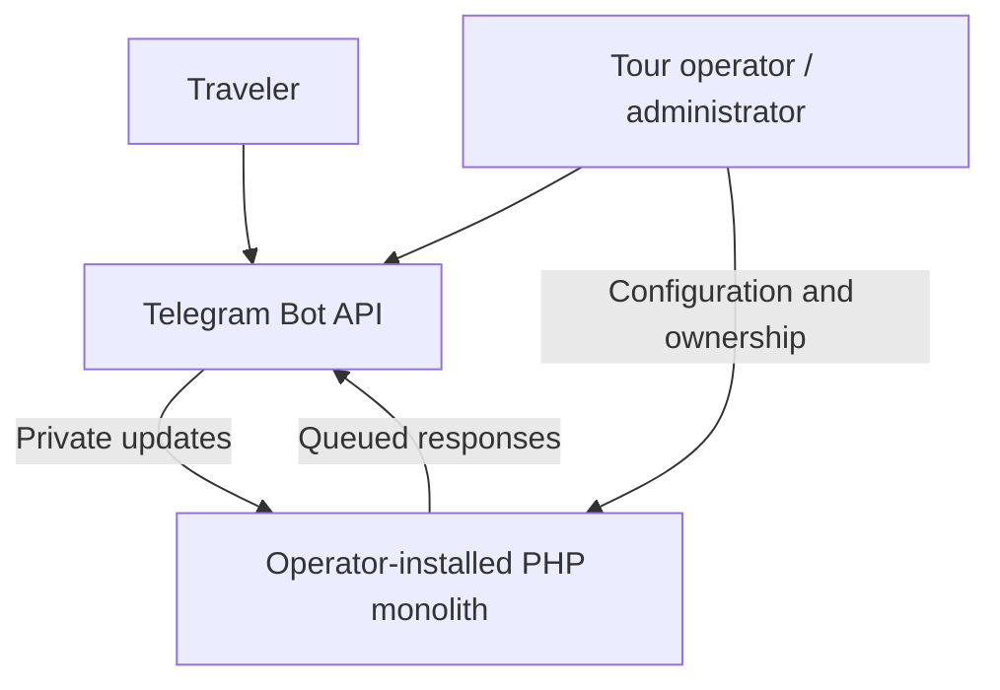
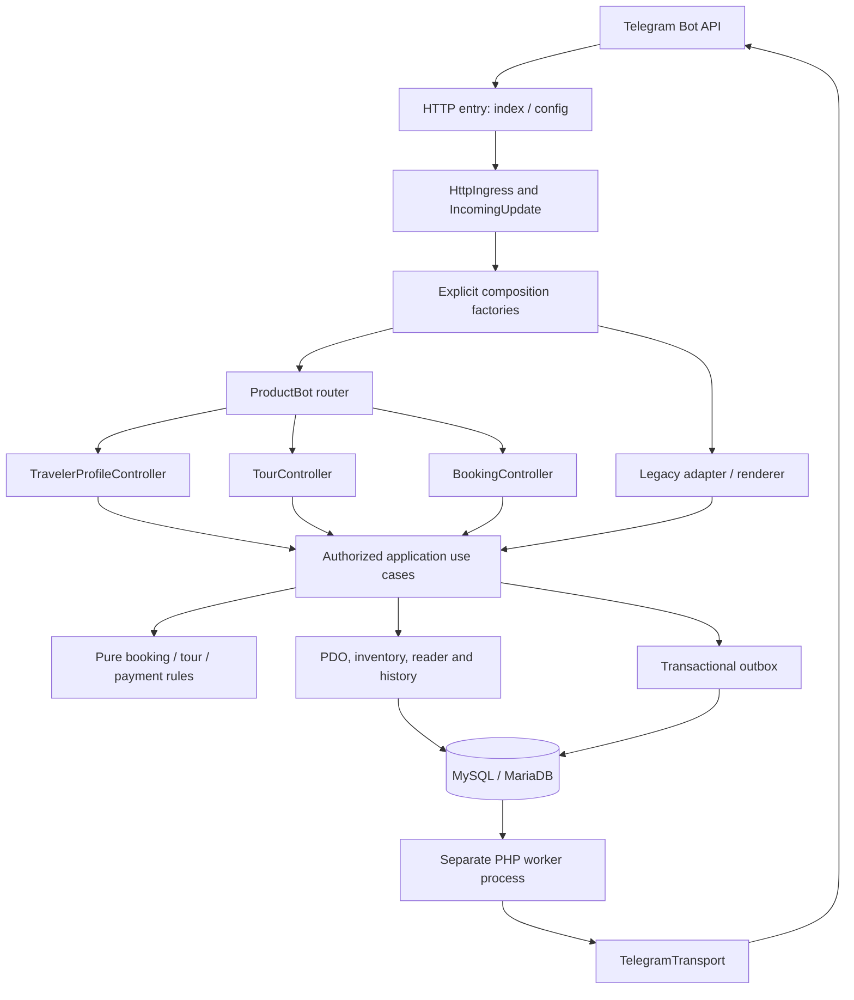

# Architecture and database contracts

The source is a **service-oriented modular monolith with lightweight clean
boundaries**. HTTP ingress and a CLI worker share PHP code and one SQL database.
It does not require microservices, a framework container, a hosted bot or any
infrastructure operated by this repository. Diagrams describe an installation
an independent operator may choose to run.

## C4-style system context

## Containers and components

Webhook and worker are processes from the same application, not independently
versioned services. `Database::atomic()` supplies the shared transaction boundary;
no component opens an independent connection during a use case.

## Responsibilities and source map

| Boundary | Main files / responsibility |
|---|---|
| HTTP entry | `config.php`, `index.php`, `public/index.php`: configuration, HTTP status/headers and composition. `HttpIngress` makes pure authentication/method/body/JSON/update decisions before PDO is opened; `IncomingUpdate` normalizes the accepted private update. |
| Composition | `BookingServiceFactory`, `ProductBotFactory`, `bin/runtime.php`: build a fixed graph from explicit PDO, owner IDs, timezone and profile policy; no lookup container. |
| Telegram presentation | `ProductBot`: dispatch, generic navigation and role/notification administration. `TravelerProfileController`, `TourController`, `BookingController`: focused conversation flows. `BotConversation`: per-update actor, form state, response sequence and formatting. |
| Tours | `TourService`: create/edit/publication; `TourRules`: pure validation; `TourCatalogService`: authorized catalogue read model; `TourCategoryService`: authorized/audited category mutations. |
| Reservations | `ReservationService`: quantity, eligibility, capacity, price snapshot, participants, initial payment/history/outbox as one unit. |
| Booking lifecycle | `BookingLifecycleService`: authorized transitions, payment prerequisite, cancellation timing, history/audit/outbox. `BookingReader`: owner/reviewer snapshots. `BookingHistoryStore`: append events in the owning transaction. |
| Compatibility API | `BookingService`: delegates the historical public API, including constructor and named arguments. It is not the owner of all business logic. |
| Payments | `PaymentReviewService`: manual review and unique hashed reference; `PaymentRules`: pure reference format. `PaymentService`/`PaymentAdapter`/`SandboxPaymentAdapter`: existing local signed simulation, not an online payment gateway. |
| Profiles and privacy | `TravelerProfileService`: self-service name/legacy-state/identity/erasure operations and separately authorized/audited leader views. `TravelerIdentity`: authenticated encryption. `PrivacyService`: erasure/retention. |
| Read models and authority | `BookingQueryService`: actor-scoped lists/history and review enrichment. `BookingReportService`: authorized aggregate/identity-free CSV. `AccessControl`: configured owners, DB roles and audit. |
| Notifications | `NotificationAdminService`: authorized overview/retry/target validation/broadcast. `Outbox`, `NotificationWorker`, `Scheduler`, `TelegramTransport`: durable intent, delivery/recovery and HTTP transport. |
| Legacy application | `LegacyTopicService`, `LegacyMembershipService`, `LegacyBroadcastService`: explicit owner authority and persisted forms. `TopicCatalogue` and `TopicMemberships`: persistence. |
| Legacy presentation | `LegacyUpdate`: explicit request value. `LegacyHandlerAdapter`: the sole handler include site. `handler.php`: scoped keyboard/message rendering without Medoo, SQL or global output helpers. `LegacyResponder`/`LegacyOutboxTransport`: injected delivery and per-update keys. |

Files remain mostly flat to preserve existing include paths and avoid directory
moves without dependency benefits. Each source type has its own file. `Payments.php`
is a compatibility loader; `NotificationWorker.php` also loads `TelegramTransport`
for historical callers. `product_bootstrap.php` is explicit class loading, not a
service locator. Existing global class names remain compatible.

## Complete reservation path

1. `HttpIngress` authenticates the secret, checks POST, bounded body/JSON and
   supported actor-owned private updates. The entry applies rejection/ack statuses
   before constructing the database graph. `IncomingUpdate` provides explicit fields.
2. `WebhookProcessor` checks the receipt, enforces the temporary rate counter and
   enters `Database::atomic()`. The unique receipt is inserted in that transaction.
3. `ProductBot` begins the shared conversation context and dispatches the command
   or callback. Tour quantity/version confirmation reaches `ReservationService`
   through the compatible booking API.
4. Reservation locks the user, tour, then existing booking/capacity rows. It checks
   duplicate quantity, expected version, name/optional verified identity,
   publication/start time, and remaining seats. Tour capacity is serialized by its
   row lock; displayed capacity is informational and is rechecked here.
5. Booking, participants, immutable price/payment snapshot, initial history and
   traveler/reviewer outbox events are written on the same PDO connection.
6. The owning webhook transaction commits receipt and all effects together.
   Repeated receipts or booking requests do not create another reservation/event.
   Validation failure rolls back and is acknowledged in a separate error-receipt
   transaction with a safe message. The worker later delivers queued intent.

## Transaction ownership and lock contracts

| Operation | Owner and lock/effect contract |
|---|---|
| Reservation | `Database::atomic` joins the webhook owner or owns a standalone call. User → tour → booking/capacity; participants/payment/history/outbox commit together. |
| Transition | Authorized snapshot → locked tour → current locked booking → payment. Fresh state decides legality; status/history/audit/outbox commit together. |
| Manual payment | Lookup booking → locked tour → booking → payment. Existing-paid idempotency, unique hashed reference, audit and outbox remain atomic. |
| Tour edit/publication | Category when applicable → tour → held booking rows. Capacity cannot shrink below used seats; version checks preserve concurrent edits. Publication reads current locked fields rather than overwriting from an old UI snapshot. |
| Category writes | Current and legacy application services join the outer transaction or own their direct call; mutation and its audit/form advancement roll back together. |
| Broadcast / legacy rendering | The incoming webhook owns recipient enqueue, acknowledgement and receipt. Outbox helpers do not independently commit. Legacy form consumption joins that transaction. |
| Worker | Advisory singleton lock, short claim/state operations, durable retry/lease state. The external HTTP call is not part of a transaction that could pretend to roll back delivery. |

`Database::atomic` joins an existing transaction without committing, rolling back
or retrying its caller's unit. An owning call retries SQL lock timeout/deadlock
(1205/1213), at most five total attempts, with bounded jitter. Other errors
propagate. `TransactionCleanup` rechecks live PDO state because the database can
already have aborted a deadlocked transaction. Unit probes verify retry limits,
auto-abort, non-retryable errors and nested ownership; real database tests exercise
rollback, concurrent reservation, transition and payment workloads.

Migration SQL and schema were not redesigned by this refactor. Existing foreign
keys, uniqueness, indexes, additive/repeatable migrations and backup/restore
contracts remain regression gates. Rollback of application rollout uses the
previous compatible source/backup plan, not automatic destructive down-migrations
or historical identity conversion. See [upgrade guidance](MIGRATION.md).

## Outbox and recovery semantics

The outbox atomically records send intent with business state. The worker uses
leases, attempts, retry delays (including Telegram 429 `retry_after`), expiry and
safe error codes. Actor/subject/permission metadata allows erasure and revoked
administrator authority to suppress queued private/export/bulk delivery. Tests
cover worker process exit/restart, database outage and supervised recovery.

Delivery is **at least once**, not exactly once: a crash after Telegram accepts a
message but before recording success can repeat delivery. Idempotent enqueue keys
and edit handling reduce duplicates but do not create an external exactly-once
contract. Temporary CSV files are private and removed after transport. Real
Telegram delivery is not contacted by the synthetic test suite.

## Security, identity and configuration

- Private-chat/actor checks and webhook secret precede database use. Callback
  parsing is bounded; application services independently check owner/reviewer/
  administrator permissions and booking ownership.
- `/setprofile` aliases secure profile UI. Stale legacy identity forms discard the
  incoming value and reset state; historical `Data.Mobile`/`N_Code` values are not
  automatically read out, migrated or rewritten. Runtime profile writes do not
  create new plaintext phone/national identifiers.
- Contact ownership and national-code structure/checksum are validated; no official
  identity lookup is claimed. Libsodium authenticated encryption uses a fresh nonce
  and a base64 32-byte key outside Git. Status/read models do not decrypt identifiers.
- CSV uses an explicit identity-free projection and formula neutralization.
  Administrator leader-name views require review/profile authority and are audited.
- Erasure rejects active bookings, removes encrypted identity through the user FK,
  clears participants/reasons/personal queue associations and anonymizes retained
  records. The short-lived security counter survives; backups and old Telegram
  messages have separate operator retention policies.
- HTTP/CLI factories explicitly capture `REQUIRE_VERIFIED_PROFILE`; application use
  cases do not read globals or environment. Only `LegacyProfileRequirement` keeps
  dynamic environment behavior for the old fallback constructor. `TravelerIdentity`
  reads the encryption key as an infrastructure configuration boundary. Source
  guards allow environment reads at these two named compatibility/crypto points
  and reject them elsewhere in `src`.

Never commit or print real credentials. Historical credential revocation must be
confirmed by the owner; deleting a current file does not revoke an old token.
See [security policy](../SECURITY.md).

## Allowed dependencies and automated controls

Presentation → authorized application services → pure rules / persistence,
crypto and outbox boundaries. Pure rule classes never depend on Telegram, HTTP or
PDO. Constructors are explicit; composition factories alone build the runtime
graph. No repository interface, inheritance hierarchy or framework container is
introduced without a concrete need. Transport replacement uses an actual callable
port; the existing sandbox has a real payment adapter contract.

Architecture tests scan real source recursively, require non-empty coverage, and
check presentation persistence/construction, domain infrastructure, global state,
source dependency cycles and the sole legacy include boundary. Nine injected
source violations must be detected. Cycle checking covers direct class references
under the current class/file naming convention; dynamic includes are not a full
interprocedural dependency proof.

PHPStan 2.3.1 runs at **level 5**, PHP target 8.0.30, without active baseline or
ignored errors. It analyzes `src` except the scoped `handler.php` template. Its
runtime owner constant is supplied by an analysis-only bootstrap. PHPCS 3.13.6
checks PSR-12 source errors; global class names remain compatible and warnings
(such as long Persian text lines) are advisory. The template is excluded from the
style gate but remains syntax-, architecture-, MySQL/MariaDB- and HTTP-tested.
Configuration/CLI entry scripts are syntax/integration tested rather than part of
that PHPStan class scope. Formatting was isolated in PR 26 and verified against
base tokens plus all behavior gates.

Both application and development dependencies are locked and audited. Actions
are pinned to resolved immutable SHAs with repository `contents: read`. PHP
8.0–8.4, MySQL 8.0, MariaDB 10.11, Docker install, HTTP, worker recovery and isolated
backup/restore are mandatory. Source compatibility with PHP 8.0 is not a hosting
recommendation; operators should use a maintained runtime.

## Decisions and remaining debt

- [ADR 0001: modular monolith](adr/0001-modular-monolith.md)
- [ADR 0002: transactional outbox](adr/0002-transactional-outbox.md)
- [ADR 0003: legacy compatibility boundary](adr/0003-legacy-handler-compatibility.md)
- [ADR 0004: encrypted traveler identity](adr/0004-encrypted-traveler-identity.md)
- [ADR 0005: explicit use cases with compatible APIs](adr/0005-explicit-use-cases.md)

Remaining non-blocking debt is the scoped legacy renderer/keyboard duplication,
array-based read contracts and level-5/template analysis limits, and global class/
include compatibility. The old environment-policy adapter is deliberate and
isolated; new runtime code must use explicit factories. High-branching UI card and
callback methods remain bounded presentation decisions, not financial/capacity
rules. Complexity reporting includes every extracted controller, avoiding an
apparent improvement by omitting moved code. See the [quality review](QUALITY_REVIEW.md).
